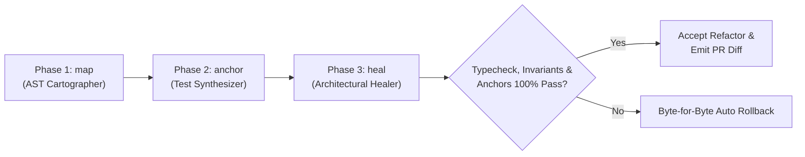

# VibeDebt

```text
 __      ___ _          _____       _     _   
 \ \    / (_) |        |  __ \     | |   | |  
  \ \  / / _| |__   ___| |  | | ___| |__ | |_ 
   \ \/ / | | '_ \ / _ \ |  | |/ _ \ '_ \| __|
    \  /  | | |_) |  __/ |__| |  __/ |_) | |_ 
     \/   |_|_.__/ \___|_____/ \___|_.__/ \__|
```

<p align="center">
  <strong>The Autonomous "Intent-to-Architecture" Refactoring Engine for the Vibe Coding Era.</strong><br>
  <em>AI generates the spaghetti; VibeDebt untangles it into production-grade modular architecture.</em>
</p>

<p align="center">
  <a href="https://github.com/tamilselvan04200803-max/vibedebt"></a>
  <a href="https://github.com/tamilselvan04200803-max/vibedebt/actions/workflows/ci.yml"></a>
  <a href="https://www.typescriptlang.org/"></a>
  <a href="https://github.com/tamilselvan04200803-max/vibedebt/tree/main/tests"></a>
  <a href="#three-phases-one-behavioral-boundary"></a>
  <a href="#deploy-with-firebase-app-hosting"></a>
  <a href="#code-quality--guarantees"></a>
</p>

---

## 🌟 Why VibeDebt? (The $1.5 Trillion Dilemma)

In 2025, Andrej Karpathy coined **"vibe coding"**—describing what you want in natural language and letting LLMs generate the code. By 2027, enterprise analysts project **$1.5 Trillion in technical debt** resulting from AI-generated applications.

When developers vibe code:
1. **The AI solves only the immediate prompt**, ignoring macro-system architecture.
2. **Duplicated algorithms proliferate**: The same discount formula, validation check, or API wrapper gets written 5 different ways across 5 monolithic files.
3. **Dead state & orphaned variables pile up**: Hallucinated drafts and unused state hooks linger forever.
4. **Code freezes**: Human maintainers can no longer reason about the system, and AI context windows become too confused to edit safely.

**VibeDebt is the reverse-compiler for intent.** It does not ask you to stop vibe coding. It embraces the workflow: **Vibe code as fast as you want—then run VibeDebt to turn it into production-ready software.**

---

## 🚀 60-Second Quickstart

Requires Node.js 24+. Run these commands from the repository root:

```sh
# 1. Install dependencies and ensure clean baseline
npm ci
node scripts/reset-fixture.js

# 2. Run the end-to-end VibeDebt pipeline with offline interactive dashboard
npm run vibedebt:run -- fixtures/vibe-mart --html

# 3. Launch the local interactive observatory
npm run serve
```

Open `http://localhost:3000` (or `vibedebt-dashboard.html`) in your browser to view the **Architecture Observatory**.

The automated run:
- **Discovers AST Topology**: Maps 6 source files, finding 37 duplicate expression clusters, 6 orphaned state variables, and 2 API path divergences.
- **Synthesizes 109 Behavioral Anchors**: Locks in exact business logic without touching internal private variables.
- **Executes Transactional Healing**: Extracts domain logic into `domain/pricing.ts` and `services/apiRoutes.ts`, verifying that **122/122 invariants and characterization tests pass**.
- **Generates Full PR Report**: Summarizes metrics in `VIBEDEBT_REPORT.md`.

Reset the repeatable benchmark at any time:
```sh
node scripts/reset-fixture.js
```

Want to preview exact file diffs first with zero disk mutation?
```sh
npm run vibedebt:run -- fixtures/vibe-mart --dry-run
```

---

## ⚡ The Three Phases: Intent to Architecture



### 1. Phase 1: Codebase Cartographer (`vibedebt map`)
- Uses `ts-morph` to traverse the Abstract Syntax Tree (AST) across all project files.
- Builds an entity-level dependency graph connecting components, state hooks, and API endpoints.
- Detects architectural code smells:
  - **Duplicated Logic**: Subtree canonicalization and AST expression clone detection.
  - **Orphaned State**: Scope taint analysis detecting write-only or unused state declarations.
  - **Inconsistent APIs**: Endpoint URL normalization uncovering divergent versions (`/api` vs `/api/v1`).
- Outputs structured topology JSON and human-readable reports.

### 2. Phase 2: Test Harness Synthesizer (`vibedebt anchor`)
- Follows the **Pure Black-Box Characterization Principle**: Observes only public boundaries (exported APIs, route handlers, user journeys).
- Synthesizes a deterministic Vitest / Playwright suite (`.vibedebt/generated-anchor.test.ts`) that achieves a **100% pass rate on unrefactored code**.
- These tests serve as an immutable regression safety net—the refactorer is judged against them without ever modifying the test assertions.

### 3. Phase 3: Architectural Refactoring Engine (`vibedebt heal`)
- Refactors monolithic components into a clean 5-layer modular architecture (`domain/`, `services/`, `hooks/`, `components/`).
- Rewires cross-file imports and exports automatically.
- Enforces an automated **Compile-and-Test Verification Loop**:
  - Compiles TypeScript (`tsc --noEmit`).
  - Runs all baseline invariants and synthesized anchors.
  - If any failure occurs, **RollbackGuard** automatically restores original source bytes and deletes newly created files.

---

## 📊 Measured Benchmark Results

### Benchmark 1: VibeMart Monolith (E-Commerce)
Measured by `npm run vibedebt:run -- fixtures/vibe-mart`:

| Metric | Before Refactor | After VibeDebt Refactor | Improvement |
| :--- | :---: | :---: | :---: |
| **Duplicated AST Expression Clusters** | 37 | **12** | **-67.6%** |
| **Orphaned State / Dead Buffers** | 6 | **0** | **-100%** |
| **API Path Inconsistencies** | 2 | **0** | **-100%** |
| **Monolithic Component Lines (LOC)** | 1,812 | **1,576** | **-236 lines** |
| **Verification Gate Pass Rate** | — | **122 / 122 (100%)** | **Zero Regressions** |

### Benchmark 2: RealWorld Conduit (`react-typescript-realworld-example-app`)
Verified against the open-source RealWorld benchmark (commit `28e1e43`):
- **Clean Extraction**: Extracted token authentication options from `user.service.ts` and `article.service.ts` into a clean shared module. All native gates and 6/6 browser Playwright journeys passed.
- **Fault-Injection Test**: Intentionally changed `Token` to `Bearer`. The TypeScript compiler passed, but the behavioral anchors failed (4 failed, 2 passed). VibeDebt rejected the mutation and restored 100% of the original files byte-for-byte.

---

## 🛡️ VibeDebt vs Alternatives

| Capability | Standard Linters (ESLint, Biome) | Raw AI Prompts ("Refactor this") | VibeDebt |
| :--- | :---: | :---: | :---: |
| **AST Duplicate Math Detection** | ❌ Formatting / Rules only | ⚠️ Inconsistent | ✅ **Subtree AST Clones** |
| **Automatic Behavioral Test Synthesis** | ❌ No | ⚠️ Hallucinates tests | ✅ **Black-Box Anchors** |
| **Architectural Module Extraction** | ❌ No | ⚠️ Introduces subtle bugs | ✅ **Domain-Layer Extraction** |
| **Automated Rollback on Test Failure** | ❌ No | ❌ Manual git reset | ✅ **Byte-Level RollbackGuard** |
| **Zero-Write Dry-Run Preview** | ⚠️ Limited | ❌ No | ✅ **Full In-Memory Diff** |
| **Offline Execution ($0 API Cost)** | ✅ Yes | ❌ Requires API | ✅ **Fully Deterministic** |

---

## 🌐 Architecture Observatory & Modern Web Design

VibeDebt includes an offline-first **Architecture Observatory** (`vibedebt-dashboard.html`) designed using modern web standards:
- **Fluid Responsive Typography**: Built with CSS `clamp()` and container queries for seamless viewing across 4K displays and mobile phones.
- **Dark-Mode First Aesthetics**: Built on CSS custom properties with high-contrast coral/teal debt visualizers.
- **Embedded Offline Mermaid Runtime**: Visualizes entity-level dependency graphs and call flows completely offline without external CDNs or network calls.
- **Interactive Source Filter**: Instant client-side search across files, duplicate clusters, and state declarations.

### Local Observatory Server
Launch the local observatory with zero external dependencies:
```sh
npm run serve
# Running at http://localhost:3000
```

---

## ☁️ Deploy with Firebase App Hosting

VibeDebt is pre-configured for automated deployment via **Firebase App Hosting**:

```text
├── firebase.json       # App Hosting configuration
└── apphosting.yaml     # Production CPU, concurrency & environment config
```

### 1-Click Deployment via Firebase CLI:
```sh
# Deploy directly from your machine
npx -y firebase-tools@latest deploy
```

### Automated CI/CD via GitHub:
Connect your repository in the [Firebase Console](https://console.firebase.google.com/) under **App Hosting** to enable automatic Git-push deployments on every commit to `main`.

---

## 💻 CLI Commands Reference

All commands support `--help`. Build first with `npm run build`:

```sh
# Map: Generate topology & debt report
node dist/cli/index.js map <targetDir> [--out <jsonPath>] [--html <htmlPath>] [--ai]

# Anchor: Synthesize behavioral characterization tests
node dist/cli/index.js anchor <targetDir> [--out <testPath>]

# Heal: Perform structural refactoring with automatic rollback
node dist/cli/index.js heal <targetDir> --anchor <testPath> [--dry-run] [--checkpoint]

# Run: Execute full pipeline (map -> anchor -> heal -> report)
node dist/cli/index.js run <targetDir> [--html <htmlPath>] [--dry-run] [--ai]
```

### Optional AI Enrichment (Deterministic by Default)
By default, VibeDebt runs 100% offline with zero API calls. If you wish to enrich domain summaries with an LLM, set any of the following environment variables:
- `OPENROUTER_API_KEY`: Uses OpenRouter (`openrouter/free` by default)
- `GEMINI_API_KEY`: Uses Google Gemini (`gemini-2.5-flash`)
- `OPENAI_API_KEY`: Uses OpenAI (`gpt-4o-mini`)

---

## 🔒 Code Quality & Guarantees

- **Strict TypeScript**: 100% TypeScript 5.8 with `strict: true`.
- **Zero `any` Types**: 0 occurrences of `any` across all 58 engine source modules.
- **Strict Modularity**: Every source file in `src/` is strictly under **250 lines of code**.
- **Complete Test Coverage**: 18 test suites, **139 passing tests** covering AST scanners, Playwright journeys, Git checkpointing, transaction rollback, and safety guards.

---

## 🤝 Contributing

```sh
# Run full verification suite
npm ci
node scripts/reset-fixture.js
npx tsc --noEmit
npx vitest run
```

All contributions must pass `npx tsc --noEmit` and `npx vitest run` with zero warnings or errors.

---

<p align="center">
  <strong>VibeDebt</strong> &mdash; <em>Untangle your architecture.</em><br>
  Released under the <a href="LICENSE">MIT License</a>.
</p>
