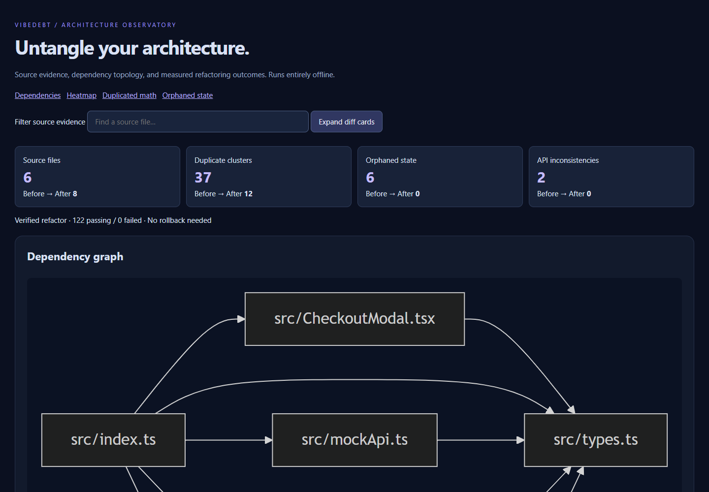
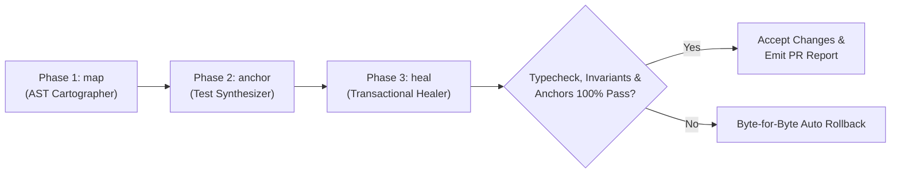

# VibeDebt

```text
 __      ___ _          _____       _     _   
 \ \    / (_) |        |  __ \     | |   | |  
  \ \  / / _| |__   ___| |  | | ___| |__ | |_ 
   \ \/ / | | '_ \ / _ \ |  | |/ _ \ '_ \| __|
    \  /  | | |_) |  __/ |__| |  __/ |_) | |_ 
     \/   |_|_.__/ \___|_____/ \___|_.__/ \__|
```

<p align="center">
  <strong>A Safety Net for AI Refactors: Evidence-First, Test-Guarded Codebase Restructuring.</strong><br>
  <em>AI writes the spaghetti. VibeDebt locks in existing behavior with black-box behavioral anchors before extracting shared domain modules under an automatic rollback guard.</em>
</p>

<p align="center">
  <a href="https://github.com/tamilselvan04200803-max/vibedebt"></a>
  <a href="https://github.com/tamilselvan04200803-max/vibedebt/actions/workflows/ci.yml"></a>
  <a href="https://www.typescriptlang.org/"></a>
  <a href="https://github.com/tamilselvan04200803-max/vibedebt/tree/main/tests"></a>
  <a href="#how-it-works-three-phases-one-safety-boundary"></a>
  <a href="#code-quality--test-enforcement"></a>
</p>

---

<p align="center">
  
</p>

---

## 🎯 The Core Idea: A Safety Net for AI Refactors

Developers love "vibe coding" with LLMs (Cursor, Copilot, Claude, GPT), but as features accumulate, code quietly drifts into monolithic files, duplicated calculation loops, fragmented API endpoints, and dead state. 

Asking an LLM to blindly "refactor this project" is risky: models easily drop edge cases, subtly alter arithmetic, or break assumptions that only integration tests would catch.

**VibeDebt acts as an automated safety harness:**
1. **Map**: Discovers AST topology, duplicated expression clusters, and unread state variables across your project.
2. **Anchor**: Treats the unrefactored code as a black box and synthesizes a runnable behavioral test suite (Vitest / Playwright) against public boundaries to freeze current behavior.
3. **Heal**: Executes atomic AST extractions into clean domain modules behind a **transactional rollback guard**. If any test or typecheck fails, VibeDebt restores the original source files byte-for-byte.

> **Scope Note**: VibeDebt provides *preserved behavior for exercised paths*, not mathematical semantic equivalence or complete test coverage. Intent summaries are heuristic (inferred from AST names and operations).

---

## 🚀 One-Command Interactive Demo

Experience the full pipeline on the author-constructed benchmark fixture:

```sh
git clone https://github.com/tamilselvan04200803-max/vibedebt.git
cd vibedebt
npm ci

# Resets fixture, runs map -> anchor -> heal, and starts the visualizer
npm run demo
```

This opens the **Architecture Observatory** at `http://localhost:3000` (or open `vibedebt-dashboard.html` offline).

---

## 🔍 Use It on Your Own Project

You can run VibeDebt's **Cartographer** on any JavaScript or TypeScript repository right now:

```sh
# 1. Map any repository and generate an offline HTML dashboard
node dist/cli/index.js map ../my-app --html my-dashboard.html

# 2. Or output structured JSON for CI/CD linting
node dist/cli/index.js map ../my-app --out topology.json
```

### What `map` gives you on any repo:
- **Dependency Graph**: Interactive Mermaid graph of imports and module relationships.
- **Duplicate Expression Clusters**: AST clone detection uncovering copy-pasted logic.
- **Orphaned State Detector**: Scope taint analysis flagging declared React state variables that are never read in JSX or effects.
- **API Boundary Divergences**: Uncovers divergent route versions (e.g. `/api/v1/users` vs `/api/users`).

### Running manifest-driven refactoring targets:
For targeted refactoring, configure a target manifest:
```json
{
  "boundary": {
    "sourceRoots": ["src"],
    "tsconfig": "tsconfig.json",
    "excludedPaths": ["dist", "coverage", "node_modules"]
  }
}
```
Run `node dist/cli/index.js target-heal --manifest manifest.json --dry-run` to preview in-memory diffs. If an unsupported code shape or unrecognized AST construct is encountered, VibeDebt **fails closed with zero disk modifications**.

---

## ⚡ How It Works: Three Phases, One Safety Boundary



1. **Phase 1: Codebase Cartographer (`vibedebt map`)**  
   Inventories functions, components, state hooks, and imports using `ts-morph`. Normalizes AST expressions to flag duplicated math clusters and dead state buffers.
2. **Phase 2: Test Harness Synthesizer (`vibedebt anchor`)**  
   Probes public exports and HTTP routes. Generates a standalone Vitest / Playwright test suite (`.vibedebt/generated-anchor.test.ts`) that achieves a 100% pass rate on the unrefactored code without importing private variables.
3. **Phase 3: Architectural Healer (`vibedebt heal`)**  
   Transforms monolithic files by extracting shared modules (e.g., domain pricing and centralized API route tables). Any test failure triggers **RollbackGuard**, which immediately restores the original byte snapshot and deletes newly generated files.

---

## 📊 Measured Benchmark Evidence

### Benchmark 1: VibeMart Monolith (Author-Constructed Fixture)
An author-constructed e-commerce monolith consisting of **6 source files (8 fixture files total)** modeling real-world vibe-coded anti-patterns:

| Metric | Before Refactor | After Refactor | Change | Notes |
| :--- | :---: | :---: | :---: | :--- |
| **Duplicated AST Expression Clusters** | 37 | **12** | -67.6% | *Clusters represent repeated AST expressions (including nested expressions); they are not 37 separate defects.* |
| **Orphaned State / Dead Buffers** | 6 | **0** | -100% | *Purged dead buffers while retaining live input drafts.* |
| **API Path Inconsistencies** | 2 | **0** | -100% | *Centralized `/api` vs `/api/v1` routes with backward-compatible aliases.* |
| **Component Source Lines (LOC)** | 1,812 | **1,576** | -13.0% | *Extracted `src/domain/pricing.ts` and `src/services/apiRoutes.ts`.* |
| **Gate Verification** | — | **122 / 122** | 100% Passed | *All 13 original fixture invariants + 109 synthesized anchor tests passed.* |

### Benchmark 2: RealWorld Conduit (`react-typescript-realworld-example-app`)
To prove generalization beyond author-constructed fixtures, VibeDebt was tested against upstream commit `28e1e43` of the community RealWorld app:
- **Precondition Disclosure**: Requires one pre-applied casing correction patch (`register-import-case.patch`, fixing `App.tsx`'s import of `Register` to match Git directory casing) before baseline anchor capture.
- **Clean Extraction Run**: Extracted authorization header options from `user.service.ts` and `article.service.ts` into a dedicated helper module (`src/api/authorization-options.ts`). All native checks (`tsc`, `jest`) and all 6 Playwright browser journeys passed.
- **Fault-Injection Test (Token ➔ Bearer)**: To verify that the anchors genuinely detect behavioral defects, the helper was mutated to emit `Bearer` instead of `Token`. The native TypeScript compiler passed, but the behavioral anchors failed (4 failed, 2 passed). VibeDebt rejected the mutation and restored the admitted source files byte-for-byte.

---

## 🔬 Qualitative Tooling Comparison

| Capability | Duplication Linters (e.g. `jscpd`) | Dead Code Detectors (e.g. `knip`) | AST Codemods (`jscodeshift`, `ts-morph`) | VibeDebt |
| :--- | :---: | :---: | :---: | :---: |
| **Duplication Detection** | Token / text clones | ❌ None | ❌ None | **Normalized AST Subtree Clones** |
| **Orphaned State Analysis** | ❌ None | Unused files/exports | ❌ None | **Scope Taint Analysis for React State** |
| **Automated Test Synthesis** | ❌ None | ❌ None | ❌ None | **Black-Box Behavioral Anchors** |
| **Refactoring Engine** | ❌ Detection only | ❌ Detection only | Scripted manual transforms | **Guided Module Extraction** |
| **Transaction Rollback** | ❌ None | ❌ None | ❌ Manual `git checkout` | **Automated Byte-for-Byte RollbackGuard** |
| **Dry-Run Diff Preview** | ❌ None | ❌ None | Diff output | **In-Memory Unified Diff Preview** |

---

## ⚠️ Supported Transforms & Known Limitations

- **Supported Healer Transforms**: Currently extracts duplicate domain calculation bodies (e.g. tiered pricing, coupon calculations) and centralizes divergent REST API route declarations into dedicated services. On generic targets, supports conservative arrow-property header extractions.
- **Fails Closed**: Unrecognized business logic shapes, complex dynamic meta-programming, or unhandled control flows abort cleanly with zero mutations to disk.
- **No Global Equivalence Claim**: VibeDebt verifies that captured behavioral vectors continue to pass. It does not prove formal mathematical equivalence for unexercised paths.
- **Local AST Intent**: Intent summaries are heuristic summaries generated by parsing AST function names and syntax branches. Optional LLM enrichment via `--ai` is advisory and never affects refactoring gates.

---

## 💻 CLI Commands Reference

Build the executable first with `npm run build`:

```sh
# Map: Analyze source topology & detect code smells
node dist/cli/index.js map <targetDir> [--out <jsonPath>] [--html [htmlPath]] [--ai]

# Anchor: Synthesize black-box behavioral characterization tests
node dist/cli/index.js anchor <targetDir> [--out <testPath>]

# Heal: Perform refactoring with automated rollback guard
node dist/cli/index.js heal <targetDir> --anchor <testPath> [--dry-run] [--checkpoint]

# Run: Full end-to-end pipeline (map -> anchor -> heal -> report)
node dist/cli/index.js run <targetDir> [--html [htmlPath]] [--dry-run] [--ai]
```

---

## 🔒 Code Quality & Test Enforcement

- **Strict File Modularity**: Every single file under `src/` is strictly under **250 lines of code**.
- **Zero `any` Types**: 0 occurrences of explicit `any` types across the entire engine.
- **Automated Verification**: Modularity and type hygiene are continuously asserted by `tests/code-quality.test.ts`.
- **Test Suite Inventory**: **139 tests passed, 1 skipped** (POSIX file mode check on Windows, 140 total) across 19 test files.
- **Hermetic Test Isolation**: Tests automatically reset fixtures before and after execution via Vitest `globalSetup`.

---

## 🤝 Contributing & Community

We welcome contributions! Please review our community guides:
- [CONTRIBUTING.md](CONTRIBUTING.md) — Architecture map, "how to add a smell detector", and "how to add a transform" walkthroughs.
- [CODE_OF_CONDUCT.md](CODE_OF_CONDUCT.md) — Contributor standards.
- [SECURITY.md](SECURITY.md) — Vulnerability reporting policy.
- [CHANGELOG.md](CHANGELOG.md) — Release notes and version history.

Run the full verification suite locally:
```sh
npm ci
npx tsc --noEmit
npx vitest run
```

---

<p align="center">
  <strong>VibeDebt</strong> &mdash; <em>A safety net for AI refactors.</em><br>
  Released under the <a href="LICENSE">MIT License</a>.
</p>
